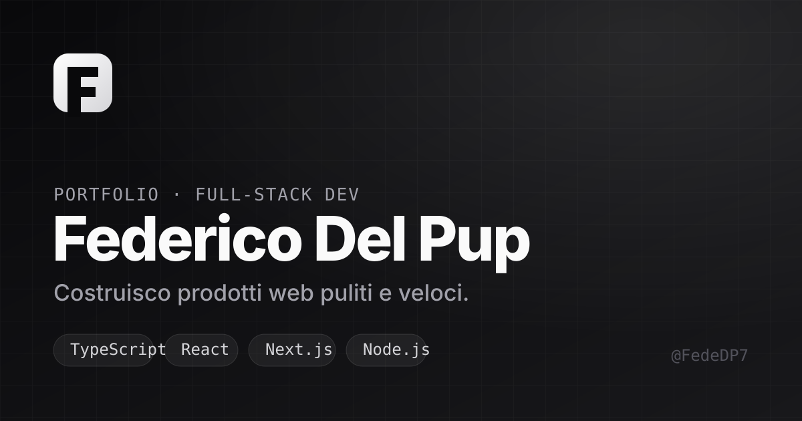

# Federico Del Pup — Portfolio

Personal portfolio website. Static, dependency-free, fast.

[](https://fededp7.github.io/FedericoDelPup-portfolio/)
[](#stack)
[](https://github.com/FedeDP7/FedericoDelPup-portfolio/actions/workflows/deploy.yml)
[](LICENSE)

**→ [Live demo](https://fededp7.github.io/FedericoDelPup-portfolio/)**

---

## Preview



## Features

- 🌗 **Dark / light theme** — system-aware, persisted in `localStorage`
- ✨ **Scroll reveal** — staggered `IntersectionObserver` animations
- 🧲 **Micro-interactions** — magnetic buttons, mouse-tracking card glow
- 📱 **Responsive** — mobile nav, fluid `clamp()` type scale
- ♿ **Accessible** — skip link, focus states, `prefers-reduced-motion`
- 🚀 **Zero runtime deps** — pure HTML/CSS/JS, instant load
- 🔍 **SEO ready** — Open Graph, Twitter cards, sitemap, canonical
- 🎨 **Custom 404** — animated, on-brand

## Stack

| Layer | Tech |
|-------|------|
| Markup | HTML5 |
| Styles | CSS3 (custom properties, grid, `color-mix`) |
| Logic | Vanilla JavaScript (ES modules pattern, IIFE) |
| Fonts | Inter · JetBrains Mono |
| Hosting | GitHub Pages |
| CI | GitHub Actions |

## Structure

```
.
├── index.html              # page
├── 404.html                # custom not-found page
├── robots.txt              # crawler rules
├── sitemap.xml             # SEO
├── assets/
│   ├── css/styles.css      # design system + components
│   ├── js/script.js        # theme, nav, reveal, interactions
│   └── img/
│       ├── favicon.svg     # logo mark
│       └── og-image.svg    # social share card
└── .github/workflows/deploy.yml
```

## Run locally

No build step. Serve the folder:

```bash
# Python
python -m http.server 8000

# Node
npx serve .
```

Open <http://localhost:8000>.

## Deploy

Pushing to `main` triggers the GitHub Actions workflow, which publishes to GitHub Pages.
One-time setup: **Settings → Pages → Source → GitHub Actions**.

## Customize

- Colors / spacing / motion → `:root` tokens in `styles.css`
- Content → sections in `index.html`
- URLs → search-replace the base URL if you fork

## License

[MIT](LICENSE) © Federico Del Pup
